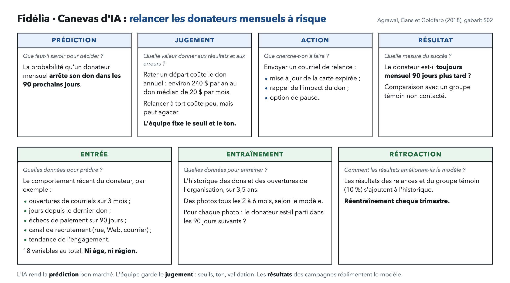
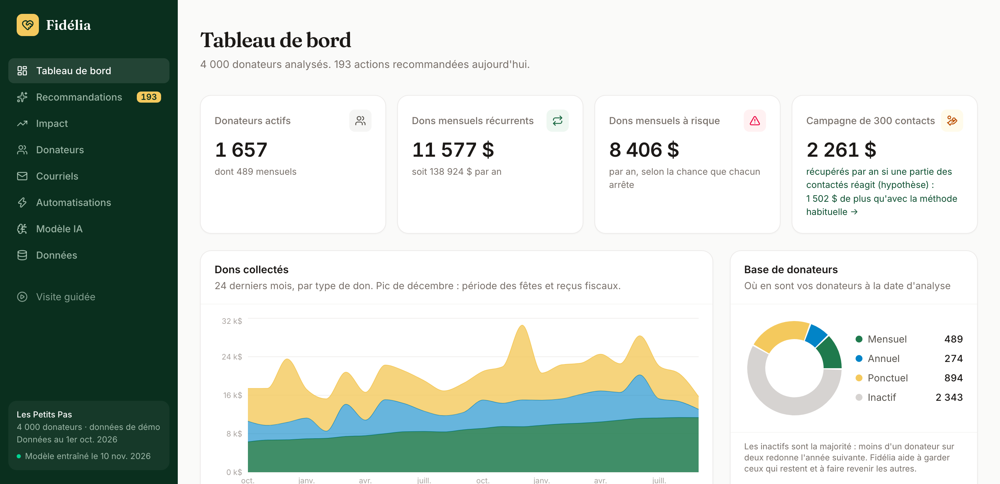
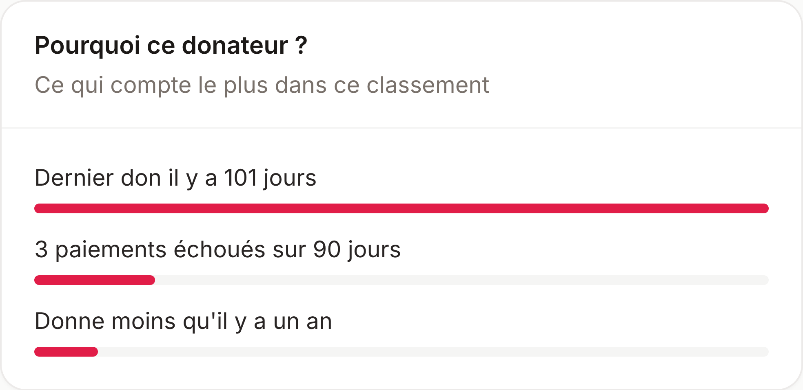

# Fidélia : qui relancer, remercier ou solliciter

**TECH 60711, Réalisation d’applications d’intelligence artificielle, HEC Montréal, automne 2026**  
**Équipe 4 :** Geoffrey Carel, Juliette Ponce, Juliette Violon, Paul Soubigou  
**Démonstration en ligne :** https://wtigg.github.io/fidelia/ (aucune installation)  
**Dépôt du code :** https://github.com/wtigg/fidelia  
**Annexes :** A à I, après les références (détails de calcul, commandes, risques, leçons complémentaires, usage de l’IA générative ; fichier source `docs/ANNEXES.md`)

## Résumé

Fidélia aide un petit organisme à but non lucratif (OBNL) à choisir chaque semaine qui relancer, remercier ou solliciter. Quatre petits modèles prédisent l’attrition, le passage au mensuel, la hausse et la réactivation. Un modèle n’est déployé que s’il bat nettement le hasard (R1) et la règle RFM (récence, fréquence, montant ; R2) ; sinon, l’outil garde RFM. Sur le jeu synthétique, 3 modèles sur 4 remplissent R1 et R2. À 100 contacts, les quatre listes réunies ciblent 4,8 fois plus de valeur que RFM et 4,9 fois plus que le hasard, sur des donateurs fictifs ; cette valeur repose sur un effet supposé des relances. Sur de vrais donateurs (KDD Cup 1998), le modèle « don plus élevé que le dernier » remplit R1 et R2. Sur KDD 98, la tâche de réactivation bat RFM mais échoue à R1 : l’application utilise son modèle de réactivation sur le jeu synthétique avec la mention « à l’essai », et nous ne le déploierions pas chez un vrai OBNL sans nouvelle preuve (section 6.2). La performance chez un vrai OBNL se vérifiera au pilote ; l’effet causal des relances, après la V1 (section 11).

> Les chiffres de performance viennent des rapports générés par les scripts du dépôt (`reports/`, `verification/`) et sont reproductibles (section 6.3), sauf les tentatives d’amélioration de la section 6.5, explorations non intégrées à la branche principale. Les coûts (section 9) sont des hypothèses : salaires sourcés, coûts d’infrastructure estimés par l’équipe.

---

## 1. Idée

### 1.1 Description

Fidélia est un outil web pour les petits OBNL (1 à 5 personnes à la collecte de fonds, sans analyste). Il lit l’historique des dons et produit chaque semaine **quatre listes ciblées**, plus une liste de remerciements :

**Tableau 1.** *Les listes d’actions produites chaque semaine*

| Liste | Question | Méthode |
|---|---|---|
| **Relancer** | Quel donateur mensuel risque d’arrêter son don dans les 90 jours ? | Modèle d’attrition |
| **Proposer le mensuel** | Quel donateur ponctuel ou annuel passerait au don mensuel dans les 6 mois ? | Modèle de conversion |
| **Réactiver** | Quel inactif redonnerait dans les 6 mois ? | Modèle de réactivation (« à l’essai », section 4.3) |
| **Solliciter plus** | Quel mensuel augmenterait son don ? | **Règle RFM conservée** (section 4.3) |
| **Remercier** (en plus des quatre listes) | Qui vient de faire un premier don, un don inhabituel ou d’atteindre un anniversaire ? | Règle simple, sans IA |

Pour chaque donateur : la probabilité, la valeur attendue (probabilité × montant annuel), les trois raisons principales et un brouillon de courriel. L’équipe valide chaque envoi.

### 1.2 Motivation

**Moins d’un donateur sur deux redonne l’année suivante** : 43,3 % de rétention en 2025, selon le Fundraising Effectiveness Project (FEP), sur 15 102 OBNL américains (Association of Fundraising Professionals [AFP] et GivingTuesday, 2026). Or garder un donateur rapporte plus que d’en recruter un (Sargeant, 2001), et le don mensuel assure un revenu régulier.

**Les petits OBNL manquent de moyens pour analyser leurs données.** Au Canada, 53 % des organismes de moins de 1 M$ de revenus confient leurs données à des employés sans formation ni mandat selon un sondage de CanadaHelps auprès de 1 470 organismes (Gandhi, 2024).

**L’IA est déjà là, mais pas pour cibler les donateurs.** 92 % des OBNL interrogés utilisent un outil d’IA, surtout pour écrire. L’usage prédictif, comme le classement des donateurs, reste rare (346 OBNL interrogés ; Virtuous et Fundraising.AI, 2026). Une petite équipe ne peut pas analyser des milliers de fiches : elle relance tout le monde avec le même message, ou personne. Fidélia concentre son peu de temps sur les bons donateurs. D’autres chiffres sont en annexe A.

### 1.3 Pourquoi l’IA ?

**Le type d’IA.** Fidélia relève de l’**analyse cognitive** (*cognitive insight*) : détecter des régularités dans des données pour prédire un comportement (Davenport et Ronanki, 2018). Fidélia satisfait aux critères d’un premier projet d’IA de Ng (2019) : victoire rapide (première version, ou V1, en 2 mois), projet ni trivial ni hors de portée (quatre classifications binaires sur des données que l’OBNL possède déjà), propre au secteur (rétention des donateurs), succès mesurable (R1 et R2, section 4.3) et partenaire crédible envisagé (une fédération d’OBNL, à approcher ; section 9.3). Trois autres idées ont été écartées : la seule rédaction de courriels par un grand modèle de langage (LLM), déjà couverte par les outils grand public ; le filtrage de richesse, qui exige des données externes et heurte la Loi 25 (loi québécoise sur les renseignements personnels, section 8.3) ; un robot conversationnel pour les donateurs, plus risqué pour une valeur incertaine.

**La méthode traditionnelle.** Le secteur utilise la **segmentation RFM** (Fader et al., 2005) : trois variables, des seuils fixes. Simple, lisible et gratuite, c’est la référence que l’IA doit battre.

**Ce que le modèle ajoute.**
1. **D’autres signaux que RFM.** Les variables les plus utiles au modèle d’attrition sont le taux d’ouverture des courriels, la récence, les échecs de paiement sur 90 jours et le canal de recrutement (`reports/evaluate-42.txt`). **Attention :** ce sont les signaux que notre générateur a lui-même placés dans les données (leçon 1). Le modèle sait les retrouver ; rien ne prouve encore qu’ils prédisent l’attrition réelle. Aucune de nos références ne chiffre ce lien : le pilote le vérifiera.
2. **Un meilleur classement des premiers noms.** En attrition, l’AUC-PR (aire sous la courbe précision-rappel, section 4.3) passe de 0,091 avec RFM à 0,243 avec le modèle (écart apparié, intervalle de confiance [IC] à 95 % : [0,058 ; 0,255]). Sur les 50 premiers noms, 34 % sont de vrais départs, contre 8 % avec RFM (section 6.2).

**Ce que le modèle n’ajoute pas :** la calibration (Fidélia calibre aussi RFM) et la lisibilité (d’où les trois raisons affichées). Son seul avantage est le classement.

**Le garde-fou.** Un modèle n’est déployé que s’il remplit R1 (deux fois mieux que le hasard) et R2 (meilleur que RFM, de façon significative) ; sinon, Fidélia garde RFM (section 4.3). Sur le jeu synthétique, 3 modèles sur 4 remplissent ces deux conditions ; pour la hausse, Fidélia garde RFM. Sur de vrais donateurs (KDD Cup 1998), une tâche sur deux les remplit (section 6.2). La réactivation, qui les remplit sur le synthétique mais pas sur de vrais donateurs, est donc affichée « à l’essai » dans l’application.

### 1.4 Solutions existantes

Trois outils de prédiction pour la collecte de fonds, consultés en novembre 2026 :

**Tableau 2.** *Outils de prédiction existants pour la collecte de fonds*

| Solution | Ce qu’elle prédit | Prix publié | Limites pour un petit OBNL québécois |
|---|---|---|---|
| **Dataro** | Attrition et hausse des mensuels, réactivation, dons majeurs (Dataro, s. d.-b) | Dès 15 000 $ par an, plus 0,10 $ par donateur actif (Dataro, s. d.-a) | Coût hors de portée. Français non mentionné |
| **Keela** (logiciel canadien de gestion des donateurs, ou CRM) | Score et montant suggéré, avec filtrage de richesse et données démographiques (Keela, s. d.-b) | 164 $ à 489 $ par mois (Keela, s. d.-a) | Méthode non décrite. Utilise des données que Fidélia exclut |
| **Bloomerang** (CRM américain) | « Prédictions de dons », sentiment des donateurs (Bloomerang, s. d.-b) | Dès 125 $ par mois ; IA avancée sur devis (Bloomerang, s. d.-b) | Méthode et performance non publiées |

*Note.* Prix tels que publiés, dans la devise affichée par chaque site, non convertis.

**Ce que ces outils ne font pas.** Aucun ne publie sa performance face à RFM. Aucun ne retire son modèle quand il ne fait pas mieux. Fidélia vise ce vide : un outil en français, peu coûteux, qui mesure et affiche honnêtement sa valeur.

### 1.5 Proposition de valeur

*Pour les responsables des dons des petits OBNL, qui n’ont ni le temps ni les compétences pour analyser leur base, Fidélia est un assistant de fidélisation. Il livre chaque semaine une courte liste priorisée de donateurs à contacter, avec la raison et un brouillon de message. Contrairement aux outils existants, Fidélia mesure sa performance face à la méthode traditionnelle, revient à cette méthode quand l’IA ne fait pas mieux, et garde l’humain aux commandes.*

### 1.6 Impact visé

La valeur d’affaires de l’IA vient d’abord d’effets de premier ordre : mieux décider et mieux utiliser le temps des employés (Enholm et al., 2022). Nous séparons le **mesuré** du **supposé**.

**Mesuré : le ciblage, sur des donateurs fictifs** (jeu de test synthétique, `reports/impact-42.json` ; montants calculés avec l’effet supposé décrit plus bas). À effort égal, les quatre listes réunies ciblent :

**Tableau 3.** *Valeur ciblée selon le nombre de contacts (jeu de test synthétique)*

| Contacts par cycle | Modèle | RFM | Hasard | Modèle ÷ RFM | Modèle ÷ hasard |
|---|---|---|---|---|---|
| 100 | 1 101 $ | 232 $ | 227 $ | **× 4,8** | **× 4,9** |
| 300 | 2 261 $ | 759 $ | 681 $ | **× 3,0** | **× 3,3** |

*Note.* Source : `reports/impact-42.json`.

Les montants appliquent l’effet supposé de chaque relance (ci-dessous). Liste par liste, les multiplicateurs mesurent seulement le **ciblage** et ne dépendent pas de cet effet. Le total pondère chaque liste par son effet supposé. Avec un effet identique pour les quatre listes, il vaudrait × 4,2 contre RFM et × 5,2 contre le hasard à 100 contacts (× 2,9 et × 3,8 à 300). Plus on contacte de monde, moins le classement compte. La liste Relancer seule ne dépend pas de l’effet supposé : avec une campagne de 300 contacts, elle cible 3,1 fois plus que RFM ; avec 100 contacts, 6,1 fois plus (`reports/impact-42.json`). L’application affiche ce chiffre sous le total. Autre lecture de la même mesure : en contactant 10 % des mensuels, le modèle d’attrition couvre 41 % des dons à risque, contre 7 % avec RFM et 10 % au hasard (courbe de valeur du test, `reports/synthetique-42.json`).

**Mesuré sur données réelles** (KDD Cup 1998). Avec 20 % des envois, le profit net de la relance est de **2 133 $ avec le modèle, contre 1 413 $ avec RFM** (+51 %). Ce chiffre valide la méthode de classement, pas un modèle déployable (section 6.2).

**Supposé : l’effet de la relance.** Pour convertir ce ciblage en dons, la page **Impact** suppose qu’une relance change le comportement de 15 à 30 % des donateurs contactés selon la liste. Ces hypothèses, réglables, sont les mêmes pour les trois stratégies. Le groupe témoin (RF14) les mesurera, une fois mis en commun entre organisations (section 5.4).

**Pour les donateurs**, un courriel au plus par 30 jours et un remerciement avant toute demande.

---

## 2. Canevas d’IA (Agrawal et al., 2018)

Le canevas suit le gabarit du cours (séance 2) : sept cases, chacune répond à une question. La figure 1 le présente sur une page ; nous détaillons ensuite le canevas principal, l’attrition. Les trois autres ne diffèrent que sur quelques cases (section 2.2).

**Figure 1.** *Canevas d’IA de Fidélia : canevas principal (attrition)*



### 2.1 Canevas principal : relancer les mensuels à risque

**Tableau 4.** *Canevas principal : relancer les mensuels à risque*

| Case | Question du gabarit | Réponse pour l’attrition |
|---|---|---|
| **Prédiction** | Que faut-il savoir pour décider ? | La probabilité qu’un donateur mensuel arrête son don dans les 90 prochains jours. |
| **Jugement** | Quelle valeur donner aux résultats et aux erreurs ? | Rater un départ coûte environ 240 $ par an (don médian de 20 $ par mois). Relancer à tort coûte peu, mais peut agacer. L’équipe fixe le seuil et le ton. |
| **Action** | Que cherche-t-on à faire ? | Envoyer un courriel de relance : mise à jour de la carte expirée, rappel de l’impact du don, option de pause. |
| **Résultat** | Quelle mesure du succès ? | Le donateur est-il toujours mensuel 90 jours plus tard ? Comparaison avec un groupe témoin non contacté. |
| **Entrée** | Quelles données pour prédire ? | Le comportement récent : ouvertures des courriels sur 3 mois, jours depuis le dernier don, échecs de paiement, canal de recrutement. 18 variables (section 5). Ni âge, ni région. |
| **Entraînement** | Quelles données pour entraîner ? | L’historique de l’organisation, en photos (l’état de chaque donateur à une date donnée) tous les 2 à 6 mois sur 3,5 ans. Pour chaque photo : le donateur est-il parti dans les 90 jours ? |
| **Rétroaction** | Comment les résultats améliorent-ils le modèle ? | Résultats des relances et du groupe témoin de 10 % ajoutés à l’historique ; réentraînement trimestriel. |

**Lecture pour un non-spécialiste.** L’IA rend la **prédiction** bon marché. L’équipe garde le **jugement** : seuils, ton, validation. Les **résultats** des campagnes réalimentent le modèle.

### 2.2 Les trois autres canevas : ce qui change

Les cases Entrée et Rétroaction sont les mêmes pour les quatre canevas ; la case Entraînement ne change que par l’étiquette et l’horizon (6 mois au lieu de 90 jours).

**Tableau 5.** *Les trois autres canevas : cases qui changent*

| Case | Passage au mensuel | Hausse | Réactivation |
|---|---|---|---|
| **Prédiction** | Passage au mensuel dans les 6 mois | Hausse du don dans les 6 mois (**règle RFM conservée**) | Nouveau don d’un inactif dans les 6 mois |
| **Jugement** | Solliciter trop tôt peut faire fuir. Le montant suggéré doit rester raisonnable | Ne jamais demander plus à un donateur à risque de départ | Coût d’un envoi contre le don moyen espéré |
| **Action** | Proposition de don mensuel, avec un montant suggéré | Demande de hausse de 5 ou 10 $ | Courriel « vous nous manquez » |
| **Résultat** | Conversion ou non en 6 mois | Hausse ou non en 6 mois | Nouveau don ou non en 6 mois |

---

## 3. Requis fonctionnels

Légende : **[IA]** = le requis repose sur un modèle d’apprentissage. **[P]** = démontré dans le prototype.

**Tableau 6.** *Requis fonctionnels*

| # | Requis | IA | Prototype |
|---|---|---|---|
| RF1 | Importer l’historique des dons et des donateurs depuis un export CSV du CRM ou de la plateforme de dons | | P |
| RF2 | Contrôler automatiquement la qualité des données importées (complétude, doublons, cohérence, actualité, consentement) | | P |
| RF3 | Calculer pour chaque donateur actif un **risque d’attrition** à 90 jours | IA | P |
| RF4 | Calculer une **propension au passage au mensuel** à 6 mois et suggérer un montant | IA | P |
| RF5 | Calculer une **propension à augmenter** le don mensuel (règle RFM conservée tant que R1 ou R2 échoue) | IA (évalué) | P (règle RFM) |
| RF6 | Calculer une **probabilité de réactivation** des inactifs | IA | P |
| RF7 | Identifier les donateurs **à remercier** (règle explicite) | | P |
| RF8 | Choisir pour chaque donateur l’action la plus utile et classer par **valeur attendue** | IA | P |
| RF9 | **Expliquer** chaque prédiction par ses trois facteurs principaux | IA | P |
| RF10 | Générer un **brouillon de courriel** personnalisé, sans montant ni fait inventé | (IA en V2) | P (gabarits) |
| RF11 | Validation humaine obligatoire avant tout envoi, modifiable par type d’action | | P |
| RF12 | Plafond de sollicitation : un courriel par donateur et par 30 jours ; remerciement prioritaire | | P |
| RF13 | Respect du consentement : aucun courriel sans consentement, lien de désabonnement | | P |
| RF14 | **Groupe témoin** de 10 % pour mesurer l’effet réel des actions | | P |
| RF15 | Tableau de bord : revenus, segments, valeur à risque, santé des modèles | IA | P |
| RF16 | Page **Impact** : dons récupérables selon la capacité de l’équipe, comparés à RFM et au hasard | IA | P |
| RF17 | Page **Modèle** : métriques, requis de performance, équité, version du modèle | IA | P |
| RF18 | Réentraînement planifié (hebdomadaire pour les scores, trimestriel pour le modèle) et retour à la version précédente | IA | P (manuel) |
| RF19 | Envoi réel par un fournisseur de courriels et suivi des ouvertures | | Non (simulé) |
| RF20 | Authentification, comptes par organisation, journal des accès | | Non |
| RF21 | Temps de réponse : liste de la semaine affichée en moins de 2 s | | P (modèle pré-entraîné) |
| RF22 | Interface en français, utilisable sur ordinateur et téléphone | | P |
| RF23 | **Opposition au profilage** (Loi 25) : un drapeau exclut le donateur de tous les modèles et listes ciblées | | Non |
| RF24 | **Accès, rectification, suppression** des données et scores d’un donateur ; scores effacés après 24 mois ; dons conservés selon les obligations fiscales | | Non |

### 3.1 Récits utilisateurs (*user stories*, extrait)

- *En tant que responsable des dons*, je veux voir chaque lundi les 50 donateurs à contacter en priorité, pour utiliser mes 2 heures de la semaine au mieux. (RF8)
- *En tant que responsable des dons*, je veux savoir **pourquoi** un donateur est signalé, pour adapter mon message et faire confiance à l’outil. (RF9)
- *En tant que directrice*, je veux savoir combien de dons l’outil peut nous faire récupérer avant de l’adopter. (RF16)
- *En tant que donateur*, je ne veux pas recevoir trois demandes dans le mois. (RF12)
- *En tant que bénévole au conseil d’administration*, je veux vérifier que l’outil ne cible pas injustement les aînés. (RF17, équité)

---

## 4. Requis techniques

### 4.1 Tâche et type de modèle

- **Tâche :** 4 problèmes de **classification binaire supervisée**, sur données tabulaires et temporelles, avec 2 à 7 % de positifs.
- **Étiquettes :** construites à partir de l’historique (photo à la date T, résultat observé sur l’horizon).
- **Algorithmes :** **régression logistique** (lisible, bien calibrée), ***gradient boosting* d’arbres** (Friedman, 2001), qui capte les seuils comme deux échecs de paiement consécutifs, et leur **ensemble**. Choix sur un jeu de validation. Ce choix suit les critères de Lee et Shin (2020) : apprentissage supervisé, données tabulaires de taille modeste, besoin d’interprétabilité ; d’où des modèles linéaires et des arbres plutôt qu’un réseau de neurones.
- **Explications (RF9) :** pour chaque donateur, chaque variable est remplacée tour à tour par sa moyenne d’entraînement ; la baisse de la prédiction (en logit) mesure sa contribution. Les trois plus fortes contributions supérieures à 0,05 sont traduites en phrases simples (fiche donateur, section 6.1). La méthode vaut pour la logistique comme pour le *boosting*. Ce sont des contributions locales, pas des causes.
- **Référence :** règle RFM par quintiles.

### 4.2 Pourquoi un modèle personnalisé plutôt qu’un modèle pré-entraîné ?

**Tableau 7.** *Options de modèle*

| Option | Évaluation |
|---|---|
| Modèle pré-entraîné (Hugging Face) | Aucun modèle public ne prédit l’attrition de donateurs |
| Service clé en main (section 1.4) | Coûteux, méthode non publiée, données confiées à un tiers |
| LLM généraliste (ChatGPT, Gemini) | Mauvais en prédiction tabulaire calibrée, non reproductible |
| **Modèle personnalisé, petit** | Entraîné sur les données de l’organisation, explicable, gratuit à l’usage |

Nous avons choisi des **modèles petits et frugaux** (Varoquaux et al., 2025), **codés à la main** en TypeScript pour le navigateur et **vérifiés contre scikit-learn** (`verification/RESULTATS.md`) : AUC-PR à 0,003 près en logistique, à 0,03 près en *boosting*.

Un **LLM pré-entraîné** reformulera les gabarits de courriels en V2, sous validation humaine, sans champ libre en entrée et sans droit d’inventer un montant (sections 7 et 8). Ce sera un modèle à poids ouverts hébergé au Canada (par exemple Llama 3 de Meta), utilisé sans réentraînement. Selon sa fiche modèle (Meta, 2024b), il a été pré-entraîné sur plus de 15 000 milliards de jetons de données publiques ; Meta n’en publie pas la liste détaillée, limite que nous vérifierons avant de le retenir (source S5, section 5.1).

### 4.3 Requis de performance

Les requis relient la métrique d’apprentissage automatique à la métrique d’affaires (Huyen, 2022, ch. 2). Ils sont vérifiés automatiquement à chaque réentraînement.

**Tableau 8.** *Requis de performance R1 à R6*

| Id | Métrique et seuil | Lien avec la métrique d’affaires |
|---|---|---|
| R1 | AUC-PR ≥ 2 × taux de base | Faire nettement mieux que le hasard ; **condition de déploiement** avec R2 |
| R2 | Écart d’AUC-PR avec RFM > 0 avec 95 % de confiance (*bootstrap* apparié : rééchantillonnage des mêmes donateurs pour les deux méthodes) | Justifier l’IA ; **condition de déploiement** avec R1 |
| R3 | Précision des 50 premiers noms ≥ RFM | Capacité hebdomadaire d’une petite équipe |
| R4 | Score de Brier (erreur quadratique moyenne des probabilités) < prédiction constante | Valeur attendue = probabilité × montant |
| R5 | AUC (aire sous la courbe ROC) du test temporel ≥ AUC du test − 0,05 | Stabilité face à la dérive |
| R6 | Calibration par tranche d’âge (prédit / observé) entre 0,67 et 1,5. Seules les tranches d’au moins 100 cas et 5 positifs comptent | Équité (section 8) |

**Fixé avant, changé après.** Les seuils de R1 à R6 ont été fixés en séance 6, avant l’entraînement, et n’ont pas bougé. Trois façons de tester ont changé après les premiers résultats. R2 comparait deux IC, test trop conservateur : il est devenu un *bootstrap* apparié. Le test temporel de R5 est passé de 2 à 4 dates : 2 dates (environ 180 exemples) donnaient des résultats erratiques. Le filtre de R6 (100 cas, 5 positifs) a été ajouté en v3, pour ne pas juger une tranche sur deux conversions. Ces changements ont été faits en voyant les résultats ; nous les déclarons (leçon 2).

**Gouvernance : R1 et R2 bloquent ; R3 à R6 alertent.** Sans R1 **et** R2, l’application classe avec la règle RFM, calibrée en probabilité. Un échec à R3, R4, R5 ou R6 ne retire pas le modèle, mais une personne responsable doit le lever avant tout usage réel. Deux modèles déployés portent une alerte : le passage au mensuel (R6) et la réactivation (R5, R6). Un ratio de sélection des 70 ans et plus supérieur à 1,5 (section 8.2) est une alerte au même titre : avant tout envoi réel, la personne responsable plafonne leur part dans la liste de conversion ou accepte l’écart par écrit dans la fiche modèle. Un dernier statut, **« à l’essai »**, signale un modèle qui remplit R1 et R2 sur nos données mais pas sur de vrais donateurs : c’est le cas de la réactivation (section 6.2). Il reste utilisé dans la démonstration, avec cette mention à l’écran. Tous les modèles restent provisoires jusqu’au pilote : l’attrition et le passage au mensuel n’ont pas d’équivalent dans KDD 98. La réactivation porte en plus la mention parce que la tâche voisine sur KDD 98 échoue à R1 ; à l’inverse, la réussite de KDD 98 pour le don plus élevé ne suffit pas à déployer notre modèle de hausse mensuelle, qui échoue sur nos propres données.

**Pourquoi l’AUC-PR ?** Avec 2 à 7 % de positifs, prédire « non » partout donne plus de 93 % d’exactitude. L’aire sous la courbe précision-rappel est plus informative (Saito et Rehmsmeier, 2015).

### 4.4 Système d’IA

**Figure 2.** *Architecture du système d’IA de Fidélia (solution cible)*

```
 CRM / plateforme de dons ──CSV──▶ Import + contrôles de qualité
 Outil de courriels (ouvertures) ─▶        │
                                           ▼
                        Calcul des 18 variables à la date d'analyse
                                           │
             ┌─────────────────────────────┼─────────────────────────────┐
             ▼                             ▼                             ▼
   Entraînement (trimestriel)     Scoring (hebdomadaire)       Règle « remercier »
   photos tous les 2 à 6 mois,    4 modèles + explications
   réglage sur validation, test,           │
   audit d'équité → model.json versionné ─▶│
                                           ▼
                    Choix de l'action (valeur attendue, garde-fous)
                                           ▼
                Brouillons de courriels → validation humaine → envoi
                                           ▼
                Résultats et groupe témoin → rétroaction au modèle
```

Comme le rappellent Sculley et al. (2015), le modèle n’est qu’une petite partie du système. La plupart des modules (import, contrôles, garde-fous, validation humaine, témoin, rétroaction) ne relèvent pas de l’apprentissage automatique, et ce sont eux qui portent l’essentiel des risques de la section 7.

### 4.5 Déploiement et technologies

La cible suit le scénario de déploiement « API, conteneur et nuage » de la séance 5 (scénario 4) : une interface de programmation (API), un conteneur Docker, un déploiement infonuagique, tout dans la région ca-central-1 (Montréal) d’Amazon Web Services (AWS).

**Tableau 9.** *Prototype livré et solution cible*

| Composante | Prototype (livré) | Solution cible |
|---|---|---|
| Interface | React 19 + TypeScript, site statique (GitHub Pages) ; image Docker nginx | Identique, derrière l’authentification |
| API | Aucune | **FastAPI** (Python) dans un conteneur Docker |
| Calcul des modèles | Navigateur (Web Worker) ; modèle pré-entraîné `model.json` | **Python et scikit-learn** sur **AWS ECS Fargate**, lancé par **EventBridge Scheduler** (scoring hebdomadaire, réentraînement trimestriel) |
| Authentification | Aucune | **Amazon Cognito**, double authentification, journal des accès (RF20) |
| Données | Locales ou CSV, jamais envoyées | **Amazon RDS for PostgreSQL**, chiffré, une base par organisation |
| Courriels | Simulés | **Amazon SES** ; si un fournisseur de courriels hors Québec est retenu, évaluation des facteurs relatifs à la vie privée (ÉFVP) d’abord (section 8.3) |
| Vérification | `npm test` (25 tests), reproductibilité, scikit-learn, déjà en intégration continue (GitHub Actions) | Mêmes contrôles, plus tests de l’API |

Le prototype exécute le modèle **côté client** (*edge*) : hébergement gratuit, données qui ne quittent pas le poste, mais surveillance difficile. D’où la tâche serveur en production.

**Langages : TypeScript pour l’interface, Python pour tout l’apprentissage automatique de la cible.** Un seul calcul des variables évite le décalage entre entraînement et service. Garder nos modèles maison violerait le principe KISS (*keep it simple*, faire simple) : l’équipe devrait les maintenir, alors que scikit-learn l’est par sa communauté. `verification/verify_sklearn.py` entraîne déjà les mêmes modèles ; il sert de garde-fou à la migration (même AUC-PR, à la tolérance mesurée près). **Interopérabilité :** l’interface React appelle l’API FastAPI en REST et JSON (schéma OpenAPI) ; elle ne reçoit que des scores, des raisons et des brouillons, jamais le modèle ni les données d’autres organisations.

---

## 5. Requis relatifs aux données

### 5.1 Sources

**Tableau 10.** *Sources de données*

| Source | Rôle | Format | Disponibilité |
|---|---|---|---|
| **S1. Jeu synthétique** (générateur du dépôt) | Entraînement et démonstration | JSON ; export CSV | Généré, reproductible (graine) |
| **S2. KDD Cup 1998** (UCI KDD Archive, s. d.) | Validation de la **méthode** sur **vrais donateurs** : réactivation, don plus élevé que le dernier | Texte délimité, 95 412 lignes × 481 champs | Public, sous conditions (`docs/DATASHEET-kdd98.md`) |
| **S3. CRM de l’organisation** | Entraînement et *scoring* réels | Export CSV | Accord de l’organisation ; Loi 25 |
| **S4. Outil de courriels** | Ouvertures mensuelles | CSV ou API | Donateurs consentants seulement |
| **S5. LLM pré-entraîné (V2)** | Reformulation des gabarits de courriels | Modèle à poids ouverts | Données d’entraînement publiques déclarées par sa fiche modèle ; aucune donnée de donateur ne sert à le réentraîner |

Aucune donnée réelle d’organisation n’est utilisée. **Limite de KDD 98 :** sa « hausse » est un inactif dont la réponse dépasse son dernier don (`TARGET_D > LASTGIFT`), pas un mensuel qui augmente son prélèvement. KDD 98 valide la méthode sur des tâches voisines, pas nos modèles.

### 5.2 Transformation

1. **Photos temporelles :** à chaque date T (tous les 2 à 6 mois, au plus 42 mois en arrière), seuls les dons antérieurs à T servent, ce qui évite les fuites. On calcule 18 variables, puis l’étiquette sur l’horizon.
2. **Transformations :** logarithme des variables asymétriques ; ouverture manquante imputée, avec un indicateur ; standardisation (logistique) ou quantiles (*boosting*).
3. **Découpage par donateur :** 60 % entraînement, 20 % validation, 20 % test. Un donateur photographié à plusieurs dates reste dans un seul jeu.
4. **Test temporel :** entraînement sur les dates anciennes, test sur les plus récentes.

Détail des variables : `docs/DATASHEET-synthetique.md`, section 4.

### 5.3 Qualité des données, par source (Strong et al., 1997)

Les dimensions suivent les quatre catégories de Strong et al. (1997) vues en séance 3 : intrinsèque (exactitude, crédibilité), contextuelle (actualité, complétude, pertinence, représentativité), représentationnelle (interprétabilité) et accessibilité.

**Tableau 11.** *Qualité des données par source et par dimension*

| Dimension | S1 synthétique | S2 KDD 98 | S3 CRM réel (anticipé) | S4 outil de courriels (anticipé) |
|---|---|---|---|---|
| Exactitude | Exacte par construction | Élevée (transactionnel) | Saisie manuelle, doublons | **Moyenne** : pixel invisible, faussé par les images bloquées ou le préchargement |
| Crédibilité | Moyenne (calibrée) | Élevée | Élevée | Bonne tendance, mauvais signal individuel |
| Actualité | Configurable | Faible (1997) | Bonne si export hebdomadaire | Agrégat mensuel |
| Complétude | 14 % sans ouvertures | Âge manquant à 25 % | Ouvertures absentes sans consentement | Absente sans courriel ou sans consentement |
| Pertinence | 4 cas d’usage | Tâches voisines | Totale | Élevée (section 1.3) |
| Représentativité | Hypothèses du générateur | États-Unis, aînés, cause unique | Propre à l’organisation | Biaisée vers les donateurs avec courriel |
| Accessibilité | Locale | Publique, sous conditions | Export CSV, Loi 25 | CSV ou API ; parfois par campagne seulement |
| Interprétabilité | Dictionnaire de données | `cup98dic.txt` | Variable selon le CRM | « Ouverture » définie par chaque outil |

**S5 (LLM, V2)** n’est pas une source de données de donateurs : ses données d’entraînement ne sont ni accessibles ni auditables (exactitude et représentativité inconnues). Nous en contrôlons donc la sortie, pas l’entrée : aucun montant ni fait absent des données, validation humaine (section 7).

**S4 demande une prudence particulière.** Le taux d’ouverture est la variable la plus utile, mais la moins fiable : un pixel ne prouve pas une lecture. Il sert de tendance sur 3 mois, jamais de fait sur une personne, et seulement avec consentement (RD5).

**L’accessibilité est le vrai risque.** Beaucoup de projets d’IA restent au laboratoire parce que les données ne sont pas accessibles en production ; c’est d’abord un problème de gestion (Vial et al., 2021). Chez un petit OBNL, les dons sont dans un CRM, les ouvertures dans un outil de courriels, et personne ne les relie. Fidélia demande un simple export CSV par source, avec un gabarit et des contrôles automatiques. Pour KDD 98, nous avons remonté jusqu’à la source et noté ses conditions d’usage, car la provenance des jeux publics est souvent mal documentée (Longpre et al., 2025).

Les contrôles mesurables sont **automatisés** dans la page **Données** (doublons, dons orphelins, dates futures, montants aberrants, actualité, consentement), selon le principe de l’adéquation à l’usage (*fit for use*).

**Création et utilisation.** À l’entraînement (S1 à S3, historique), les dimensions critiques sont la complétude et la représentativité : elles décident de ce que le modèle peut apprendre. Au *scoring* hebdomadaire (S3 et S4, données fraîches), ce sont l’actualité et l’accessibilité, contrôlées par RD4 à RD6 (section 5.4).

### 5.4 Volume minimal de données et démarrage à froid

« Y a rien de magique », rappelle la consigne du travail : un modèle n’apprend rien sans assez d’exemples. Les courbes d’apprentissage (tableau 12, détail en annexe B) donnent un ordre de grandeur. Positifs estimés = exemples × taux de base.

**Tableau 12.** *Courbes d’apprentissage (extrait)*

| Modèle | Exemples (entraînement et validation) | Positifs (environ) | AUC-PR | Seuil R1 |
|---|---|---|---|---|
| Attrition | 321 | 22 | 0,129 | 0,134 : **échoue** |
| Attrition | 1 603 | 108 | 0,225 | réussit |
| Attrition | 3 207 | 216 | 0,243 | réussit |
| Réactivation | 464 | 18 | 0,063 | 0,079 : **échoue** |
| Réactivation | 2 311 | 91 | 0,111 | réussit |

*Note.* Source : `reports/evaluate-42.txt`.

Les positifs du tableau 12 sont comptés sur l’entraînement et la validation ; RD1 les compte sur tout l’historique. Autour de 20 positifs, les deux modèles échouent à R1 ; vers 100, ils atteignent 90 à 93 % de leur AUC-PR finale. D’où **RD1 : au moins 100 événements positifs** par modèle, sinon repli sur RFM. Un OBNL de 300 mensuels observe environ 20 départs par trimestre : il lui faut environ **5 trimestres** d’historique.

**Le groupe témoin.** Chez ce même OBNL, un témoin de 10 % compte 30 donateurs, soit environ 2 départs par trimestre. Détecter une baisse de 30 % des départs demande environ **1 100 à 1 300 mensuels témoins**. Il faut donc **mettre en commun les témoins d’environ 40 organisations**. Le calcul est détaillé en annexe B.

**Tableau 13.** *Requis de données RD1 à RD6*

| # | Requis | Vérification | Vaut pour |
|---|---|---|---|
| RD1 | Au moins **100 événements positifs** par modèle dans l’historique | Compté à chaque entraînement ; sinon repli sur RFM ; sous 100 exemples d’entraînement, dont 10 positifs (3 en validation, 3 en test), liste non proposée | Entraînement |
| RD2 | **Schéma minimal** en CSV : donateurs (`id`, `email`, `email_consent`…), dons (`donor_id`, `date`, `amount`…), ouvertures facultatives ; liste complète en annexe B | Lignes illisibles écartées et comptées | Les deux |
| RD3 | **Historique** suffisant pour RD1 (environ 5 trimestres pour 300 mensuels) | Calculé à l’import | Entraînement |
| RD4 | **Fraîcheur** : dernier don enregistré il y a moins de 31 jours | Contrôle « Actualité » de la page Données | *Scoring* |
| RD5 | **Consentement** : courriels (Loi canadienne anti-pourriel, LCAP), suivi des ouvertures, opposition au profilage (RF23) | Filtre avant le calcul des variables | Les deux |
| RD6 | **Seuils bloquants** (V1) : 0 doublon d’identifiant, 0 don orphelin, 0 don futur ; le reste en avertissement | Page Données | Les deux |

Dans le prototype, les contrôles signalent sans bloquer et un consentement absent vaut « oui » ; en V1, RD6 bloquera et il vaudra « non ».

**Sous le seuil :** repli sur RFM (par défaut), attente d’un historique suffisant, ou, en V2, un modèle commun à plusieurs organisations, avec leur accord, une ÉFVP, et R1 et R2 vérifiés chez chacune.

### 5.5 Documentation

**Tableau 14.** *Résumé des fiches de données*

| Rubrique (Gebru et al., 2021) | Jeu synthétique (S1) | KDD Cup 1998 (S2) |
|---|---|---|
| Composition | 4 000 donateurs fictifs, 17 909 dons, 18 variables ; taux de base de 1,8 à 6,7 % | 95 412 donateurs inactifs depuis 13 à 24 mois, 481 champs |
| Utilisation | Entraînement, test et démonstration ; usages exclus listés | Validation de la méthode seulement ; pas de modèle déployé |
| Transformation | Photos temporelles et 18 variables (section 5.2) | Mêmes étapes, variables adaptées au jeu |
| Distribution | Dépôt public, régénérable par graine | Non redistribué ; téléchargé depuis l’UCI KDD Archive |
| Maintenance | Graine fixe, versionnage, contrôle de calibration (`npm run calibration`) | Jeu figé (1998) |

**Calibration du générateur et écart assumé.** La rétention globale simulée est de 42,9 % (cible FEP : 43,3 %) et celle des mensuels de 77,2 % à 12 mois. Les nouveaux donateurs restent toutefois trop fidèles : 29,6 %, contre 18,9 % publié (annexe A). Le générateur surestime donc leur fidélité ; nous le déclarons sans le corriger, pour ne pas toucher au jeu après l’entraînement.

- `docs/DATASHEET-synthetique.md` et `docs/DATASHEET-kdd98.md` (Gebru et al., 2021) : motivation, composition, processus, prétraitement, usages, distribution, maintenance.
- `docs/MODEL_CARD.md` (Mitchell et al., 2019) : usage prévu, performances, équité, limites, surveillance.

---

## 6. Prototype

### 6.1 Ce qu’il démontre

Application web fonctionnelle, en français, en local, dans Docker et en ligne sans installation (https://wtigg.github.io/fidelia/). Huit pages :

- **Tableau de bord :** revenus, dons mensuels à risque, encadré « Campagne de 300 contacts » (dons récupérés si une partie des contactés réagit, comparés à RFM), priorités du jour et carte « Fidélia fait-il mieux que la méthode habituelle ? », où la réactivation porte le badge « À l’essai ».
- **Recommandations :** listes par action (Proposer le mensuel y apparaît en deux onglets, « Ponctuel → mensuel » et « Annuel → mensuel »), raisons, bouton « Préparer tous les courriels ».
- **Impact :** valeur ciblée selon le nombre de contacts (modèle, RFM, hasard), effets supposés réglables, encadré « Testé sur de vrais donateurs ».
- **Donateurs :** fiche avec probabilité, trois raisons et historique sur 24 mois.
- **Courriels :** brouillons signés « L’équipe des Petits Pas » (OBNL fictif), validation, envoi simulé, onglet « Mis de côté pour mesurer » (témoin).
- **Automatisations :** taille de chaque liste, garde-fous, bouton « Préparer les courriels de la semaine ».
- **Modèle IA :** requis, décision de déploiement, écart apparié, courbes, calibration, équité, onglet « Données réelles » (KDD 98, tâches « Réactivation » et « Don supérieur au dernier »).
- **Données :** import CSV, contrôles de qualité, « Exemple complet (3 fichiers) » et bouton « Remettre la démo à zéro ».

Une **visite guidée** de six étapes enchaîne tableau de bord, recommandations, fiche d’un donateur à relancer (toujours le même donateur fictif, aussi montré sur l’affiche), impact, modèle et courriels. Les performances sont mesurées sur des « donateurs gardés pour le test », jamais vus à l’entraînement.

**Figure 3.** *Tableau de bord du prototype (jeu synthétique de 4 000 donateurs)*



**Figure 4.** *Fiche donateur : les trois raisons affichées pour un risque d’attrition (RF9)*



### 6.2 Résultats principaux

**Jeu synthétique, test (donateurs gardés pour le test, graine 42, valeur initiale du générateur aléatoire) :**

**Tableau 15.** *Résultats sur le jeu synthétique (test, graine 42)*

| Modèle | Taux de base | Fidélia AUC-PR [IC 95 %] | RFM AUC-PR [IC 95 %] | Écart [IC 95 % apparié] | Précision des 50 premiers (Fidélia / RFM) | Utilisé |
|---|---|---|---|---|---|---|
| Attrition | 6,7 % | **0,243** [0,162 ; 0,377] | 0,091 [0,068 ; 0,139] | +0,152 [0,058 ; 0,255] | 34 % / 8 % | Modèle (*boosting*) |
| Passage au mensuel | 1,8 % | **0,113** [0,076 ; 0,195] | 0,043 [0,031 ; 0,080] | +0,070 [0,028 ; 0,124] | 24 % / 12 % | Modèle (ensemble) |
| Réactivation | 3,9 % | **0,123** [0,080 ; 0,241] | 0,039 [0,027 ; 0,060] | +0,084 [0,036 ; 0,187] | 18 % / 2 % | Modèle (*boosting*) |
| Hausse | 4,1 % | 0,076 [0,047 ; 0,134] | 0,066 [0,042 ; 0,113] | +0,011 [−0,024 ; 0,059] | 10 % / 4 % | **Règle RFM** (repli) |

*Note.* Source : `reports/synthetique-42.json` et `reports/evaluate-42.txt`.

**Requis R1 à R6 validés par le meilleur candidat : 17 sur 24 (6 requis × 4 modèles).** Attrition : 6 sur 6, mais R6 ne passe que grâce au filtre ajouté en v3 : la tranche des 70 ans et plus (126 cas, 2 départs) est exclue, et son ratio prédit / observé vaudrait 2,28 ; les 55-69 ans passent de justesse (0,68 pour un seuil de 0,67). Sans ce filtre, le total serait de 16 sur 24. Passage au mensuel : échec à R6. Réactivation : échecs à R5 et R6. Hausse : échecs à R1, R2, R4 et R6, sur un modèle non déployé. Nous n’avons modifié ni les seuils ni le générateur pour corriger ces échecs.

**Pourquoi RFM ne fait pas mieux que le hasard en attrition et en réactivation.** À 100 contacts, RFM cible 140 $ contre 191 $ pour le hasard en attrition, et 11,7 $ contre 17,6 $ en réactivation (`reports/impact-42.json`). La cause est le générateur : un mensuel actif donne chaque mois, sa récence varie très peu, et RFM perd sa meilleure variable. Les départs y viennent de signaux que RFM ne voit pas : échecs de paiement, carte expirée, baisse des ouvertures, recrutement dans la rue. Sur KDD 98 aussi, RFM fait à peine mieux que le hasard (AUC 0,53), car tous les donateurs y sont inactifs depuis 13 à 24 mois. Battre RFM est donc une barre basse ; c’est pourquoi R1 exige aussi de battre nettement le hasard. RFM n’est pas un épouvantail choisi pour flatter le modèle : pour la hausse, l’application garde RFM, alors que RFM n’y cible que 0,56 fois la valeur du hasard.

**Robustesse :** sur 5 autres jeux générés (`npm run robustness`), le modèle a une AUC-PR supérieure à RFM dans **20 cas sur 20**. Il remplit la condition de déploiement (R1 + R2) dans **15 cas sur 20** :

**Tableau 16.** *Robustesse sur 5 autres jeux générés*

| Modèle | Fidélia AUC-PR | RFM AUC-PR | Déployé (R1 + R2) |
|---|---|---|---|
| Attrition | 0,209 ± 0,032 | 0,097 ± 0,007 | 5/5 |
| Réactivation | 0,215 ± 0,032 | 0,087 ± 0,012 | 5/5 |
| Passage au mensuel | 0,106 ± 0,065 | 0,042 ± 0,018 | 4/5 |
| Hausse | 0,103 ± 0,040 | 0,057 ± 0,011 | 1/5 |

*Note.* Source : `reports/robustesse.json`.

**Données réelles, KDD Cup 1998 (18 824 donateurs de test, sur 95 412) :**

**Tableau 17.** *Résultats sur données réelles (KDD Cup 1998)*

| Tâche | Taux de base | Fidélia AUC-PR [IC 95 %] | RFM AUC-PR [IC 95 %] | Écart [IC 95 % apparié] | R1 (≥ 2 × taux de base) | Déployable (R1 + R2) |
|---|---|---|---|---|---|---|
| Réactivation | 5,08 % | **0,083** [0,075 ; 0,094] | 0,053 [0,049 ; 0,058] | +0,030 [0,022 ; 0,039] | 0,083 < 0,102 : **échoue** | Non |
| Don plus élevé que le dernier | 1,73 % | **0,040** [0,033 ; 0,050] | 0,019 [0,017 ; 0,021] | +0,021 [0,016 ; 0,031] | 0,040 ≥ 0,035 : réussit | **Oui** |

*Note.* Source : `reports/kdd98.json`.

- **Don plus élevé que le dernier : R1 et R2 sont remplis.** Le modèle repère ces donateurs 2,2 fois mieux que RFM (AUC-PR 0,040 contre 0,0186, arrondi à 0,019 dans le tableau 17), chiffre affiché dans l’onglet « Don supérieur au dernier » de l’application. C’est notre preuve, sur données réelles, qu’un modèle de cette famille peut remplir nos deux conditions. La tâche reste voisine de la nôtre, pas identique (section 5.1).
- **Réactivation : R2 est rempli, R1 échoue.** Avec 20 % des envois, le profit net de la relance est de **2 133 $ contre 1 413 $** pour RFM (+51 % ; dollars américains de 1997). Mais 0,083 reste sous 2 × 5,08 % ≈ 0,102, et même la borne haute de l’IC (0,094). Plus de données n’y change rien : la courbe d’apprentissage est plate (0,082 avec 7 660 exemples, 0,083 avec 76 588). Selon notre propre règle, **nous ne déploierions pas ce modèle** sur ces données. Il valide la méthode de classement, pas un modèle prêt à l’emploi. Dans l’application, le modèle de réactivation entraîné sur le synthétique remplit R1 et R2 ; il reste utilisé, mais marqué « à l’essai » tant qu’un vrai OBNL ne l’a pas confirmé. Le reste du rapport renvoie à ce paragraphe.

**À retenir.** Sur données réelles, l’AUC baisse d’environ 0,1 par rapport au synthétique (leçon 1) ; nous attendons un écart semblable au pilote.

### 6.3 Reproduire

Le `Dockerfile` fige Node et les dépendances (`npm ci`), selon la démarche de portabilité de la séance 5. `docker run --rm fidelia-eval` lance les 25 tests, réentraîne la graine 42 et compare le résultat à `reports/synthetique-42.json`, à 10⁻⁹ près. GitHub Actions refait ces contrôles à chaque *push* sur la branche principale et à chaque demande de fusion : l’analyse statique, les tests et la reproductibilité bloquent la publication ; l’image Docker est construite et testée dans une tâche séparée, sans bloquer. Commandes complètes : `README.md` et annexe C.

### 6.4 Différences entre le prototype et la solution cible

Courriels simulés ; calcul dans le navigateur ; pas d’authentification ; données synthétiques ; gabarits plutôt que LLM ; modèles maison plutôt que scikit-learn ; ni opposition au profilage ni purge (RF23, RF24) ; témoin tiré donateur par donateur (10 % en moyenne ; 11 des 181 donateurs lors de la préparation groupée de la démonstration, environ 6 %) plutôt que par stratification ; alertes R3 à R6 affichées sur la page Modèle, mais sans blocage ni levée formelle par une personne responsable. La cible garde les mêmes variables et algorithmes, réécrits avec scikit-learn (section 4.5).

### 6.5 Peut-on rendre l’IA meilleure ? Quatre tentatives

Après la v3, règle stricte (explorations non intégrées à la branche principale ni à `reports/`) : décisions sur la validation, test évalué une seule fois par tentative, seuils, séparation et générateur inchangés. La version déployée, dite v4 (`model.json`, v20261110.0138), est celle de tous les chiffres du rapport. Seuil fixé avant d’adopter un candidat : +10 % d’AUC-PR ou un verdict R1 ou R2 qui change, de façon stable entre jeux.
- **KDD 98, plus de variables** (74 candidates) : aucune famille ne gagne en validation ; AUC-PR inchangée à 0,0825.
- **KDD 98, réglage du modèle** (une trentaine de réglages) : 0,0813, léger recul dans le bruit.
- **Synthétique, hausse** (12 nouvelles variables) : 0,084 sur la graine 42, mais le gain ne tient pas sur les 5 autres jeux ; R2 échoue toujours.
- **Combinaison des deux modèles (candidat v5)** : moyenne des rangs de la logistique et du *boosting*, choisie par validation croisée sur 6 jeux, sans lire le test. Sur les 24 cas de test (6 jeux × 4 modèles), l’AUC-PR moyenne gagne 2,4 % ; v5 gagne 13 cas sur 24 et recule un peu en attrition. Aucune décision R1 ou R2 ne change sur la graine 42 ; sur KDD 98, 0,0819 en réactivation et 0,0412 pour le don supérieur (contre 0,0825 et 0,0401). Le seuil n’est pas atteint : nous gardons la v4. scikit-learn, bien réglé, fait jeu égal avec la v4 (10 cas gagnés sur 24). La v4 essayait déjà la moyenne des deux probabilités (« ensemble ») parmi ses candidats ; v5 en diffère par la moyenne des rangs. Réserve : les tests des graines 1 à 5 avaient déjà été lus par la tentative précédente ; ils n’ont servi à aucun choix, mais la confirmation reste à garanties faibles.

Le gain est trop faible pour changer de modèle : ce sont les données qui limitent, plus que l’algorithme. Sur KDD 98, toutes les variantes restent entre 0,080 et 0,083 en réactivation. Détail en annexe D.

---

## 7. Risques

Les onze risques principaux ; les risques secondaires sont en annexe E.

**Tableau 18.** *Risques principaux*

| Catégorie | Risque | Probabilité / gravité | Mesure |
|---|---|---|---|
| Données | Données réelles sales (doublons, montants saisis à la main) | Élevée / moyenne | Contrôles automatiques à l’import (RF2) ; seuils bloquants (RD6) |
| Données | Historique trop court : moins de 100 événements positifs | Élevée / moyenne | RD1 : repli automatique sur RFM ; modèle commun en V2 (section 5.4) |
| Modèle | Modèle inadapté au réel, ou signal trop faible (réactivation sur KDD 98) | Élevée / élevée | Réentraînement sur les données de l’organisation ; R1 et R2 bloquants ; alertes levées par un humain |
| Modèle | Dérive : crise, inflation, nouvelle campagne | Moyenne / moyenne | R5, suivi hebdomadaire, réentraînement trimestriel, retour à la version précédente |
| Usage | Confondre propension et effet causal | Élevée / moyenne | Groupe témoin (RF14) ; effet traité comme hypothèse dans la page Impact |
| Usage | Automatisation excessive, envois sans relecture | Moyenne / élevée | Validation humaine par défaut (RF11) |
| Légal | Profilage sans information ni droit d’opposition (Loi 25) | Moyenne / élevée | Avis de profilage, opposition (RF23), accès et purge (RF24), section 8.3 |
| Infrastructure | Fuite de la base de donateurs | Faible / très élevée | Prototype : rien ne quitte le navigateur. Cible : hébergement au Canada, chiffrement, comptes séparés |
| Individuel | Donateur sans courriel ou sans consentement : jamais contacté, ou mal classé | Moyenne / moyenne | Variable d’absence ; listes « hors courriel » ; part des exclus affichée |
| Sociétal | Fatigue : tous les OBNL ciblent les mêmes « bons » donateurs | Moyenne / moyenne | Plafond d’un courriel par 30 jours (RF12) ; aucune limite entre organisations |
| LLM (V2) | Fuite vers un fournisseur hors Canada ; montant inventé | Moyenne / élevée | Champs non nominatifs, ÉFVP ; tout montant ou date de la sortie vérifié contre les données ; validation humaine (Meta, 2024a) |

---

## 8. Éthique

### 8.1 Sources de tort tout au long du cycle (Suresh et Guttag, 2021)

La première colonne situe chaque source dans le cycle de vie ; les lignes Collecte et Maintenance complètent le cadre.

**Tableau 19.** *Sources de tort tout au long du cycle de vie*

| Étape | Source | Dans Fidélia | Mesure |
|---|---|---|---|
| Collecte | Suivi des ouvertures | Le taux d’ouverture vient d’un pixel invisible ; le donateur ne le sait pas toujours | Lu seulement avec consentement ; mentionné dans l’avis de profilage |
| Collecte | Représentation | Synthétique = nos hypothèses ; KDD 98 = donateurs américains d’un OBNL d’anciens combattants, 1997 | Réentraînement sur les données de l’organisation |
| Données | Biais historique | Le modèle de conversion classe plus haut les 70 ans et plus (ratio de sélection 1,80, IC 95 % [1,51 ; 2,10], `reports/impact-42.json`). L’effet vient du générateur, qui lie attachement et âge. Ce n’est pas contradictoire avec la sous-estimation de la ligne « Apprentissage » : leur taux de base (5,2 %) dépasse de loin la moyenne, si bien que le modèle les classe haut tout en sous-estimant leur probabilité | Plafond de sollicitation, suivi du ratio par âge, audit sur données réelles |
| Données | Mesure | « Inactif » = 12 à 14 mois sans don selon la source : définition arbitraire | Documentée, paramétrable |
| Modèle | Agrégation | Un même modèle pour tous les donateurs | Un modèle par cas d’usage, pas par segment, faute de positifs (RD1) ; calibration suivie par tranche d’âge (R6) ; un segment mal calibré déclenche une alerte |
| Modèle | Apprentissage | Sans l’âge, le modèle de conversion **sous-estime** les 70 ans et plus (prédit / observé = 0,54, environ 38 conversions) et **surestime** les 35-54 ans (2,24, environ 8 conversions) | Audit R6 ; arbitrage vie privée et calibration en annexe G |
| Évaluation | Évaluation | Petits effectifs par tranche d’âge : une conversion de plus change beaucoup le ratio. Le modèle d’attrition sélectionne moins les 55-69 ans (ratio 0,42, IC 95 % [0,13 ; 0,68]) et les 70 ans et plus (0,48 [0,22 ; 0,80]), qui partent moins dans le générateur | IC par *bootstrap*, test temporel, 5 graines, données réelles ; R6 sans IC pour l’instant |
| Utilisation | Déploiement | Score utilisé hors de son but (p. ex., retirer des services) | Fiche modèle : usages exclus |
| Maintenance | Boucle de rétroaction | Le modèle apprend sur des données que ses relances ont changées | Témoin de 10 % jamais contacté (RF14) ; R5 ; retour arrière |

### 8.2 De la composante au tort (Rismani et al., 2025)

Chaque composante est reliée à un attribut, un seuil mesurable, un danger et un tort. Trois exemples ; tableau complet en annexe F.

**Tableau 20.** *De la composante au tort : trois exemples*

| Composante | Attribut | Mesure (seuil) | Danger | Tort |
|---|---|---|---|---|
| Score de conversion | Équité par âge | Alerte si le ratio de sélection des 70 ans et plus dépasse 1,5 (mesuré : 1,80) ou si la calibration sort de [0,67 ; 1,5] | Sur-sollicitation des aînés | Pression financière |
| Brouillon par LLM (V2) | Fidélité et confidentialité | 0 montant inventé ; 0 donnée nominative envoyée | Hallucination, fuite | Donateur trompé, sanction (Loi 25) |
| Modèle en production | Stabilité | R5 ; AUC-PR glissante > RFM | Dérive non détectée | Décisions dégradées |

### 8.3 Cadre légal et normatif

- **Loi 25** (*Loi modernisant des dispositions législatives en matière de protection des renseignements personnels*, 2021) : le *scoring* est un **profilage**. Plus on protège la vie privée, moins la donnée est utile, et les quasi-identifiants comme l’âge permettent la réidentification (Vial et al., 2024). Mesures : avis de profilage et droit d’opposition (RF23) ; accès, rectification, suppression et durée de conservation (RF24) ; ni âge, ni région dans le modèle ; ÉFVP avant tout transfert hors Québec ; responsable de la protection des renseignements personnels désigné.
- **LCAP** (Loi canadienne anti-pourriel) : consentement, identification de l’expéditeur, désabonnement.
- **Cadre de gestion des risques de l’IA** (AI RMF ; National Institute of Standards and Technology [NIST], 2023) : *Gouverner* (fiche modèle, responsable) ; *Cartographier* (canevas, risques) ; *Mesurer* (R1 à R6, équité) ; *Gérer* (surveillance, retour arrière, témoin).
- **Déclaration de Montréal** (Université de Montréal, 2018) : autonomie, intimité, prudence, responsabilité.

### 8.4 Humain dans la boucle

Fidélia suggère, l’équipe décide : c’est de l’**augmentation**, pas de l’automatisation (Raisch et Krakowski, 2021). Les raisons affichées permettent de questionner la recommandation (*engaged augmentation* ; Lebovitz et al., 2022).

### 8.5 Trois questions de la séance 4 (Varoquaux et al., 2025)

- **Environnement :** impact faible ; aucun processeur graphique (GPU), quelques secondes de processeur pour entraîner les quatre modèles (`reports/evaluate-42.txt`).
- **Plus de données, à quel risque ?** Le modèle commun de la V2 regrouperait plusieurs OBNL : seulement après échec à RD1 et une ÉFVP.
- **Concentration de pouvoir ?** Méthode publiée ; le client part avec ses données et son modèle. Détail en annexe F.

---

## 9. Estimations

### 9.1 Ressources humaines (V1, 2 mois)

Le prototype contient déjà modèles, évaluation, interface et tests. Reste le serveur, l’authentification, les vrais envois et la Loi 25. Principe KISS : un développeur à temps plein, appuyé à temps partiel (ETP : équivalent temps plein). Taux : salaires médians à Montréal (Gouvernement du Canada, 2025a, 2025b), plus 25 % de charges (hypothèse) ; détail en annexe H.

**Tableau 21.** *Ressources humaines de la V1*

| Rôle | Charge | Heures | Coût salarial | Tâches |
|---|---|---|---|---|
| Développeur web | 1 ETP | 303 | 13 838 $ | Serveur, tâche planifiée, authentification, CSV, courriels, Loi 25 |
| Scientifique de données | 0,25 ETP | 76 | 3 469 $ | Portage en Python, surveillance, audit d’équité du pilote |
| Chef de produit et designer d’expérience utilisateur (UX) | 0,15 ETP | 45 | 2 054 $ | Entrevues, tests utilisateurs, accessibilité |
| **Total** | **1,4 ETP** | **424** | **19 361 $** ; **24 201 $** chargé | |

**Hypothèse optimiste :** ces 424 heures (dont 303 de développement) supposent que le portage réutilise `verify_sklearn.py` et les gabarits existants. Scénario prudent, à × 1,5 ou × 2 : 3 à 4 mois, 36 302 à 48 402 $ pour l’équipe, soit une V1 d’environ 43 000 à 62 000 $ avec la réserve. Le temps du personnel des OBNL pilotes n’est pas chiffré.

### 9.2 Ressources matérielles

Exploitation pour 50 organisations : **105 à 350 $ par mois** (AWS ca-central-1, estimation de l’équipe), soit une base PostgreSQL 50 à 150 $ ; conteneurs de *scoring* 20 à 50 $ (environ 1 min de processeur par organisation et par semaine) ; interface 0 à 20 $ ; courriels 25 à 100 $ ; LLM en V2 10 à 30 $ (inclus par prudence dans les marges de la V1). Soit 2,10 à 7 $ par client, supposé linéaire au-delà. **Stockage :** au plus 50 Mo par organisation. **Calcul :** aucune carte graphique. **Développement :** portables et offre gratuite de GitHub.

### 9.3 Ressources financières

**Tableau 22.** *Coût de la V1*

| Coût de la V1 | Montant | Source |
|---|---|---|
| Équipe, charges comprises | 24 201 $ | Section 9.1 |
| Conseiller juridique (Loi 25), environ 10 h | 2 000 $ | Hypothèse : 200 $/h |
| Pilote avec 2 OBNL (3 mois) | 1 050 $ | Borne haute : environnement complet facturé même pour 2 clients, 3 × 350 $ |
| Réserve pour imprévus, 10 à 20 % | 2 700 à 5 500 $ | Hypothèse |
| **Total V1** | **environ 30 000 à 33 000 $** | |
| Scénario prudent (équipe × 1,5 à 2) | environ 43 000 à 62 000 $ | Section 9.1 |

**Tableau 23.** *Coûts annuels récurrents*

| Coût annuel récurrent | Montant | Calcul |
|---|---|---|
| Maintenance et support aux OBNL (0,25 ETP) | 25 963 $ | 455 h × 45,65 $ × 1,25 |
| Obligations légales (ÉFVP, responsable), environ 10 h | 2 000 $ | Hypothèse : 200 $/h |
| Assurance responsabilité et cyberrisques | non chiffrée | Soumission à obtenir |
| **Coûts fixes** | **environ 28 000 $** (2 330 $ par mois) | Hors assurance |

La vente passe par les fondateurs et une fédération d’OBNL, sans poste dédié la première année (hypothèse).

**Taille du marché.** Pour l’exercice 2024, 15 414 organismes de bienfaisance enregistrés au Québec ont produit leur déclaration T3010, dont 12 436 (81 %) avec moins de 1 M$ de revenus (Agence du revenu du Canada [ARC], 2026 ; calcul de l’équipe, annexe H). Notre cible la plus probable, les organismes de bienfaisance (hors fondations) de 100 000 $ à 1 M$ de revenus, en compte 5 962. Ce décompte ne couvre que les organismes de bienfaisance enregistrés (ceux qui délivrent des reçus fiscaux), une partie des OBNL. Le seuil de 100 000 $ suit RD1 : 300 mensuels à 20 $ par mois donnent déjà environ 72 000 $ par an. Tous ne sollicitent pas des dons récurrents ; le marché adressable est donc plus petit, et il n’est pas mesuré.

**Seuil de rentabilité.** Prix envisagé : 49 à 99 $ par mois. Après infrastructure, la marge par client est de 42 à 47 $ au prix de 49 $, et de 92 à 97 $ au prix de 99 $. Exploitation seule : environ 25 à 26 clients à 99 $ (50 à 56 à 49 $). Avec la V1 amortie sur 3 ans (833 à 908 $ par mois) : **33 à 36 clients à 99 $** (68 à 78 à 49 $), soit environ 0,6 % des 5 962 organismes de la cible (1,1 à 1,3 % à 49 $). En scénario prudent (V1 de 43 000 à 62 000 $, section 9.1), le seuil monte à 37 à 45 clients à 99 $.

**Hypothèse forte : le support.** Un quart de poste pour environ 35 clients laisse 13 h par client et par an, environ une heure par mois. C’est plausible seulement si l’import reste un CSV standard et si la fédération assure le premier niveau d’aide. Nous ne l’avons pas vérifié. **Sensibilité :** si le support double (0,5 ETP), les coûts fixes passent à environ 4 494 $ par mois ; le seuil monte à 47 à 49 clients à 99 $, et à **55 à 59 clients** avec l’amortissement de la V1.

### 9.4 Échéancier de la V1 (2 mois, puis pilote)

**Estimation en temps :** V1 construite en 2 mois (3 à 4 mois en scénario prudent, section 9.1), puis pilote de 3 mois ; lancement à la fin du mois 5 (mois 6 à 7 en scénario prudent).

L’échéancier suit les étapes de la feuille de route d’Anderson et Coveyduc (2020) : besoin d’affaires et données (mois 1), construction (mois 2), pilote (mois 3 à 5), lancement et mise à l’échelle (après).

**Tableau 24.** *Échéancier de la V1*

| Période | Livrable | Requis |
|---|---|---|
| Mois 1 | Entrevues avec 5 OBNL, connecteur CSV, portage en Python et scikit-learn, tâche planifiée, API, authentification ; opposition au profilage, accès et purge prêts **avant** de scorer de vrais donateurs | RF1 à RF9, RF15 à RF18, RF20 à RF24 |
| Mois 2 | Interface, courriels réels, validation, plafond, consentement, groupe témoin, documentation Loi 25 | RF11 à RF14, RF19, RD1 à RD6 |
| Mois 3 à 5 | **Pilote** avec 2 OBNL (accord écrit) : R1, R2 et équité sur leurs données ; lancement à la fin | RF17 |
| Après | Suivi de la conversion sur 6 mois ; effet causal sur témoins mis en commun | RF14 |

**V1 :** RF1 à RF9 et RF11 à RF24 ; RF18 en version simple (réentraînement lancé à la main) ; RF10 en gabarits. **V2 :** LLM (RF10), connecteurs API, modèle commun.

---

## 10. Leçons apprises

Cinq leçons ; trois autres (équité par âge, versionnage du modèle, piège de mesure en validation croisée) sont en annexe G.

1. **Un modèle entraîné sur du synthétique apprend d’abord le générateur.** L’AUC de nos modèles déployés atteint 0,71 à 0,82 sur le synthétique, mais 0,62 à 0,68 sur les deux tâches de KDD 98. Leurs variables « les plus utiles » sont celles que nous avions placées dans le générateur (section 1.3). Le synthétique protège la confidentialité et démontre le système ; il ne remplace pas une validation réelle. Il faut écrire ce qu’il prouve et ce qu’il ne prouve pas (Jarrahi et al., 2023 ; Sambasivan et al., 2021).

2. **Se méfier des résultats trop beaux et de ses propres règles d’évaluation.** Après correction de dons datés avant l’inscription, la réactivation a atteint une AUC suspecte de 0,94. Deux fuites : un donateur inscrit le jour de la photo comptait comme « inactif », et un nouveau mensuel comme une « hausse » de 0 $. Corrigée, l’AUC est revenue à 0,75 (Sculley et al., 2015 ; Kapoor et Narayanan, 2023). La façon de tester compte aussi : comparer deux IC aurait rejeté notre modèle de conversion, 2,6 fois meilleur que RFM. Mais nous avons changé ce test, le test temporel et le filtre de R6 après avoir vu des résultats (section 4.3). Il faut fixer d’avance les seuils **et** la façon de les tester, ou déclarer chaque changement.

3. **RFM est une référence sérieuse, et de meilleures données valent mieux qu’un meilleur modèle.** Sur KDD 98, quand on écrit à 68 % des donateurs, RFM fait un peu mieux que le modèle (2 422 $ contre 2 320 $) : l’avantage du modèle est de bien classer les premiers noms. Battre RFM ne suffit pas, il faut aussi battre nettement le hasard (section 6.2). Quatre tentatives d’amélioration, dont une trentaine de réglages et une combinaison de modèles, n’ont apporté aucun gain robuste (section 6.5) ; choisir la meilleure sur le test aurait été facile. Pour progresser, il faut des données plus riches (Jarrahi et al., 2023). L’IA doit gagner sa place cas d’usage par cas d’usage.

4. **Prédire n’est pas causer.** Un modèle de propension cible des donateurs qui auraient peut-être agi seuls. Seul un groupe témoin mesure l’effet de l’action. La page Impact sépare donc le mesuré (le ciblage) du supposé (l’effet de la relance).

5. **La faisabilité se calcule avant de coder.** Autour de 20 positifs, nos modèles échouent à R1. Un OBNL de 300 mensuels observe environ 20 départs par trimestre : plus d’un an d’historique est nécessaire, et son groupe témoin ne prouvera jamais seul l’effet des relances. D’où RD1, le repli sur RFM et la mise en commun des témoins (section 5.4). C’est le conseil de Ng (2019) et le constat de Vial et al. (2021) : le frein est souvent l’accès aux données, pas l’algorithme.

---

## 11. Conclusion et viabilité

**Ce qui est prouvé.** La méthode classe mieux que RFM : 3 modèles sur 4 remplissent R1 et R2 sur le jeu synthétique, et 15 cas sur 20 sur 5 autres jeux. Sur de vrais donateurs, une tâche remplit R1 et R2 ; l’autre bat RFM mais échoue à R1 (section 6.2). La gouvernance fonctionne : elle garde RFM pour la hausse et marque la réactivation « à l’essai ».

**Ce qui ne l’est pas.** L’effet causal des relances, que la page Impact suppose. La performance chez un vrai OBNL québécois (leçon 1).

**Trois menaces pour la pérennité.**
1. **Le volume de données.** Environ 5 trimestres d’historique pour un OBNL de 300 mensuels (section 5.4). Les plus petits resteront sur RFM, sans gain de l’IA.
2. **La rentabilité.** Une V1 de 30 000 à 62 000 $ selon le scénario (section 9.1), puis environ 35 clients à 99 $ par mois (37 à 45 en scénario prudent), ou 55 à 59 si le support coûte le double (section 9.3). Le marché potentiel compte 5 962 organismes de bienfaisance québécois dans la cible (section 9.3), mais il faut le convaincre organisme par organisme.
3. **La Loi 25.** Profilage, opposition, ÉFVP, purge : une organisation peut renoncer par prudence.

Pour reprendre l’expression de la consigne, « dans la vraie vie », Fidélia pourrait ne pas être viable comme produit vendu seul. Une subvention ou une fédération d’OBNL est plus réaliste.

**Condition de poursuite.** Un pilote de 3 mois avec 2 OBNL (section 9.4). On continue si, chez chacun, au moins un modèle valide R1 et R2, et si l’équipe utilise les listes chaque semaine. Sinon, l’outil reste une aide RFM simple, ce qui a déjà une valeur. L’effet causal se mesurera après la V1, avec les témoins d’environ 40 organisations.

---

## Références

Format APA 7. Les DOI ont été vérifiés ; les pages Web ont été consultées le 9 novembre 2026, sauf mention contraire. Certaines références ne sont citées que dans les annexes. Au sens de la consigne (« provenant du plan de cours ou non »), 28 des 49 références sont académiques, marquées d’un astérisque (\*) : 21 articles de revues ou d’actes avec comité de lecture et 7 lectures du plan de cours (*Harvard Business Review*, *MIT Sloan Management Review*, ouvrages d’Anderson et Coveyduc et de Huyen).

Agence du revenu du Canada. (2026). *Liste des organismes de bienfaisance 2024* [Jeu de données : identification et données financières, T3010]. Gouvernement ouvert du Canada. Consulté le 23 novembre 2026, sur https://ouvert.canada.ca/data/fr/dataset/80c00cdb-1358-415c-bb8b-0de7f12675b8

\* Agrawal, A., Gans, J. et Goldfarb, A. (2018, 17 avril). A simple tool to start making decisions with the help of AI. *Harvard Business Review*. https://hbr.org/2018/04/a-simple-tool-to-start-making-decisions-with-the-help-of-ai

\* Anderson, J. L. et Coveyduc, J. L. (2020). *Artificial intelligence for business: A roadmap for getting started with AI*. Wiley.

Association of Fundraising Professionals et GivingTuesday. (2026). *Fundraising Effectiveness Project: Quarterly report, Q4 2025*. https://data.givingtuesday.org/fep-report/

Bloomerang. (s. d.-a). *Donor retention* [glossaire]. Consulté le 9 novembre 2026, sur https://bloomerang.com/nonprofit-glossary/donor-retention

Bloomerang. (s. d.-b). *Pricing*. Consulté le 9 novembre 2026, sur https://bloomerang.com/pricing/

Charity Insights Canada Project. (2026, 8 octobre). *Mind the gap: Demand and capacity in Canada’s charitable sector*. Carleton University. https://carleton.ca/cicp-pcpob/2026/mind-the-gap-demand-and-capacity-in-canadas-charitable-sector/

Dataro. (s. d.-a). *Plans and pricing*. Consulté le 9 novembre 2026, sur https://dataro.io/pricing/

Dataro. (s. d.-b). *Available Dataro Predict models*. Consulté le 9 novembre 2026, sur https://support.dataro.io/knowledge/available-dataro-predict-models

\* Davenport, T. H. et Ronanki, R. (2018). Artificial intelligence for the real world. *Harvard Business Review*, *96*(1), 108–116.

\* Enholm, I. M., Papagiannidis, E., Mikalef, P. et Krogstie, J. (2022). Artificial intelligence and business value: A literature review. *Information Systems Frontiers*, *24*(5), 1709–1734. https://doi.org/10.1007/s10796-021-10186-w

\* Fader, P. S., Hardie, B. G. S. et Lee, K. L. (2005). RFM and CLV: Using iso-value curves for customer base analysis. *Journal of Marketing Research*, *42*(4), 415–430. https://doi.org/10.1509/jmkr.2005.42.4.415

\* Friedman, J. H. (2001). Greedy function approximation: A gradient boosting machine. *The Annals of Statistics*, *29*(5), 1189–1232. https://doi.org/10.1214/aos/1013203451

Gandhi, S. (2024, 26 mars). *More than half of small non-profits relying on ‘accidental techies’: CanadaHelps survey*. Future of Good. https://futureofgood.co/more-than-half-of-small-non-profits-relying-on-accidental-techies-canadahelps-survey

\* Gebru, T., Morgenstern, J., Vecchione, B., Vaughan, J. W., Wallach, H., Daumé, H., III et Crawford, K. (2021). Datasheets for datasets. *Communications of the ACM*, *64*(12), 86–92. https://doi.org/10.1145/3458723

Gouvernement du Canada. (2025a). *Salaire de scientifique des données (CNP 21211) dans la région de Montréal*. Guichet-Emplois. Consulté le 9 novembre 2026, sur https://www.guichetemplois.gc.ca/rapportmarche/salaire-profession/17887/geo25154

Gouvernement du Canada. (2025b). *Salaire de programmeur en développement de logiciels (CNP 21232) dans la région de Montréal*. Guichet-Emplois. Consulté le 9 novembre 2026, sur https://www.guichetemplois.gc.ca/rapportmarche/salaire-profession/22531/22446

\* Huyen, C. (2022). *Designing machine learning systems: An iterative process for production-ready applications*. O’Reilly Media.

\* Jarrahi, M. H., Memariani, A. et Guha, S. (2023). The principles of data-centric AI. *Communications of the ACM*, *66*(8), 84–92. https://doi.org/10.1145/3571724

Johnson, L. (2023, 2 août). *How nonprofits can use donor retention strategies to ensure success*. ASU Lodestar Center for Philanthropy and Nonprofit Innovation. https://lodestar.asu.edu/blog/2023/08/how-nonprofits-can-use-donor-retention-strategies-ensure-success

\* Kapoor, S. et Narayanan, A. (2023). Leakage and the reproducibility crisis in machine-learning-based science. *Patterns*, *4*(9), Article 100804. https://doi.org/10.1016/j.patter.2023.100804

Keela. (s. d.-a). *Pricing*. Consulté le 9 novembre 2026, sur https://keela.co/pricing

Keela. (s. d.-b). *Nonprofit intelligence*. Consulté le 9 novembre 2026, sur https://www.keela.co/solutions/nonprofit-intelligence

\* Kleinberg, J., Mullainathan, S. et Raghavan, M. (2017). Inherent trade-offs in the fair determination of risk scores. Dans *8th Innovations in Theoretical Computer Science Conference (ITCS 2017)* (Leibniz International Proceedings in Informatics, vol. 67, article 43, p. 1–23). Schloss Dagstuhl. https://doi.org/10.4230/LIPIcs.ITCS.2017.43

\* Kreuzberger, D., Kühl, N. et Hirschl, S. (2023). Machine learning operations (MLOps): Overview, definition, and architecture. *IEEE Access*, *11*, 31866–31879. https://doi.org/10.1109/ACCESS.2023.3262138

\* Lebovitz, S., Lifshitz-Assaf, H. et Levina, N. (2022). To engage or not to engage with AI for critical judgments: How professionals deal with opacity when using AI for medical diagnosis. *Organization Science*, *33*(1), 126–148. https://doi.org/10.1287/orsc.2021.1549

\* Lee, I. et Shin, Y. J. (2020). Machine learning for enterprises: Applications, algorithm selection, and challenges. *Business Horizons*, *63*(2), 157–170. https://doi.org/10.1016/j.bushor.2019.10.005

*Loi modernisant des dispositions législatives en matière de protection des renseignements personnels*, L.Q. 2021, c. 25 (Loi 25). https://www.publicationsduquebec.gouv.qc.ca/fileadmin/Fichiers_client/lois_et_reglements/LoisAnnuelles/fr/2021/2021C25F.PDF

\* Longpre, S., Singh, N., Cherep, M., Tiwary, K., Materzynska, J., Brannon, W., Mahari, R., Obeng-Marnu, N., Dey, M., Hamdy, M., Saxena, N., Anis, A. M., Alghamdi, E. A., Chien, V. M., Yin, D., Qian, K., Li, Y., Liang, M., Dinh, A., … Kabbara, J. (2025). Bridging the data provenance gap across text, speech and video. Dans *The Thirteenth International Conference on Learning Representations (ICLR 2025)*. https://doi.org/10.48550/arXiv.2412.17847

Meta. (2024a). *Meta Llama responsible use guide: Resources and best practices for responsible development of products built with large language models*. https://ai.meta.com/static-resource/responsible-use-guide

Meta. (2024b). *Llama 3 model card*. GitHub. Consulté le 9 novembre 2026, sur https://github.com/meta-llama/llama3/blob/main/MODEL_CARD.md

\* Mitchell, M., Wu, S., Zaldivar, A., Barnes, P., Vasserman, L., Hutchinson, B., Spitzer, E., Raji, I. D. et Gebru, T. (2019). Model cards for model reporting. Dans *Proceedings of the Conference on Fairness, Accountability, and Transparency (FAT\* ’19)* (p. 220–229). ACM. https://doi.org/10.1145/3287560.3287596

National Institute of Standards and Technology. (2023). *Artificial intelligence risk management framework (AI RMF 1.0)* (NIST AI 100-1). https://doi.org/10.6028/NIST.AI.100-1

\* Ng, A. (2019, 6 février). How to choose your first AI project. *Harvard Business Review*. https://hbr.org/2019/02/how-to-choose-your-first-ai-project

Nguyen, T. K. Q. (2024, 17 décembre). *The rising demand for data literacy and AI in charities*. Charity Insights Canada Project, Carleton University. https://carleton.ca/cicp-pcpob/2024/the-rising-demand-for-data-literacy-and-ai-in-charities/

\* Raisch, S. et Krakowski, S. (2021). Artificial intelligence and management: The automation–augmentation paradox. *Academy of Management Review*, *46*(1), 192–210. https://doi.org/10.5465/amr.2018.0072

\* Rismani, S., Shelby, R., Davis, L., Rostamzadeh, N. et Moon, A. (2025). Measuring what matters: Connecting AI ethics evaluations to system attributes, hazards, and harms. *Proceedings of the AAAI/ACM Conference on AI, Ethics, and Society*, *8*(3), 2199–2213. https://doi.org/10.1609/aies.v8i3.36706

\* Saito, T. et Rehmsmeier, M. (2015). The precision-recall plot is more informative than the ROC plot when evaluating binary classifiers on imbalanced datasets. *PLOS ONE*, *10*(3), Article e0118432. https://doi.org/10.1371/journal.pone.0118432

\* Sambasivan, N., Kapania, S., Highfill, H., Akrong, D., Paritosh, P. et Aroyo, L. M. (2021). “Everyone wants to do the model work, not the data work”: Data cascades in high-stakes AI. Dans *Proceedings of the 2021 CHI Conference on Human Factors in Computing Systems* (p. 1–15). ACM. https://doi.org/10.1145/3411764.3445518

\* Sargeant, A. (2001). Relationship fundraising: How to keep donors loyal. *Nonprofit Management and Leadership*, *12*(2), 177–192. https://doi.org/10.1002/nml.12204

\* Sculley, D., Holt, G., Golovin, D., Davydov, E., Phillips, T., Ebner, D., Chaudhary, V., Young, M., Crespo, J.-F. et Dennison, D. (2015). Hidden technical debt in machine learning systems. Dans *Advances in Neural Information Processing Systems* (vol. 28, p. 2503–2511). Curran Associates. https://proceedings.neurips.cc/paper/2015/hash/86df7dcfd896fcaf2674f757a2463eba-Abstract.html

\* Strong, D. M., Lee, Y. W. et Wang, R. Y. (1997). Data quality in context. *Communications of the ACM*, *40*(5), 103–110. https://doi.org/10.1145/253769.253804

\* Suresh, H. et Guttag, J. (2021). A framework for understanding sources of harm throughout the machine learning life cycle. Dans *Equity and Access in Algorithms, Mechanisms, and Optimization (EAAMO ’21)* (p. 1–9). ACM. https://doi.org/10.1145/3465416.3483305

UCI KDD Archive. (s. d.). *KDD Cup 1998 data*. Consulté le 9 novembre 2026, sur https://kdd.ics.uci.edu/databases/kddcup98/kddcup98.html

Université de Montréal. (2018). *Déclaration de Montréal pour un développement responsable de l’intelligence artificielle*. https://declarationmontreal-iaresponsable.com/la-declaration/

\* Varoquaux, G., Luccioni, A. S. et Whittaker, M. (2025). Hype, sustainability, and the price of the bigger-is-better paradigm in AI. Dans *Proceedings of the 2025 ACM Conference on Fairness, Accountability, and Transparency* (p. 61–75). ACM. https://doi.org/10.1145/3715275.3732006

\* Vial, G., Crowe, J. et Mesana, P. (2024). Managing data privacy risk in advanced analytics. *MIT Sloan Management Review*, *65*(4), 47–51.

\* Vial, G., Jiang, J., Giannelia, T. et Cameron, A.-F. (2021). The data problem stalling AI. *MIT Sloan Management Review*, *62*(2), 47–53.

Virtuous et Fundraising.AI. (2026). *The 2026 nonprofit AI adoption report*. https://virtuous.org/blog/the-2026-nonprofit-ai-adoption-report-blog/
